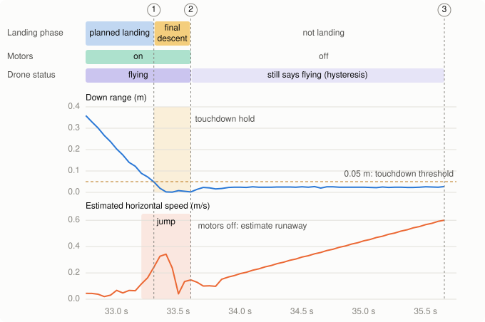

# 2026-11-04-first-flight-1-hover

> Flown on 2026-11-04 at 17:16 Pacific. The Flights table and "Computed from
> the logs" are by Claude, from the recorded log. Pass or fail, and Joe's own
> observations, are Joe's to write.

- **Session:** [First flight 1](../sessions/2026-11-04-first-flight-1.md)
- **Test:** Hover (flight)
- **Environment:** [Living room](../environments/living-room.md), hide-and-seek launch point, all lights on, plus a flashlight on the floor aimed at the take-off spot. Time of day / sunlight: after dark
- **Git commit:** `3c59ee7` (must be committed before flying; same code as `de24a7c`)
- **Hardware:** Crazyflie 2.1+, decks: Flow / Multi-ranger / Buzzer, battery #
- **Firmware / cflib:** 2026.08, release 2026.10, unmodified ([ADR-0047](../../decisions/0047-pinned-firmware-release-warn-on-mismatch.md)) / 0.1.34

## Goal and pass criteria
*Written before flying.*

- Goal: First hover through the project's own code: arm, take off to 0.5 m,
  hover, land, using the hover program (ADR-0030). Measure the drift over
  60 s and settle the flight-related `VERIFY` items.
- Pass if (drift is measured, not passed or failed, so there is no distance
  limit):
  - [ ] The hover test reports done: armed within 2 s, reached 0.5 m (within
        0.1 m) within 5 s, hovered, landed, no error logged.
  - [ ] A 60 s hover is flown, and the drift over it is measured from the
        recording and by eye, and recorded.
  - [ ] The distance from the take-off point to the landing point is
        measured with a tape measure (the drone's own estimate drifts) and
        recorded.
  - [ ] Motors stop only after touchdown is confirmed. A landing that needed
        the final descent still passes, but is recorded as a finding.
  - [ ] Each `VERIFY` item below is confirmed or turned into a code change or
        backlog item.

### `VERIFY` items
- How the drone settles at the floor while the landing go_to holds it there
  (`adapter.py`, ADR-0032).
- Touchdown placeholders: down range at or below 0.05 m held for 0.3 s, final
  descent 0.1 m/s, margin 2 s (`touchdown.py`).
- `TAKE_OFF_STATUS_GRACE` of 1.0 s (`adapter.py`).
- Hover test placeholders: height tolerance 0.1 m, arm limit 2 s, take-off
  limit 5 s (`hover_test.py`).
- Vertical speed 0.3 m/s and hover settle time 1 s (`adapter.py`).

## Pre-flight checklist

- [ ] Bench, Failsafe low and Failsafe high passed
- [ ] Code committed, hash recorded above
- [ ] Mock adapter run of this exact code passed
- [ ] Propellers undamaged, battery charged (voltage: ___)
- [ ] Soft landing patch under the drone, flight area clear of people and pets
- [ ] Geofence configured for this space
- [ ] Video recording on

## During the test

- [ ] Mark the take-off point on the floor
- [ ] Start: `.venv\Scripts\python -m crazyflie_behavior.programs.hover --crazyflie --hover-seconds 60`
- [ ] Watch the flight; note anything unexpected while it happens
- [ ] After landing, measure from the take-off mark to the drone with a tape measure
- [ ] Note whether the landing needed the final descent (the log says so)

## Flights

| # | What was run | Result | Data file | Notes |
|---|---|---|---|---|
| 0 | `hover --hover-seconds 60` (mock) | Done, exit 0 | (console only) | |
| 1 | `hover --crazyflie --hover-seconds 60` | "Hover test: landed. Done."; the final descent ran | `logs/2026-11-04_17-16-20_hover.log` | Joe: landed about 4 cm from the take-off point; slid about 4-8 cm in total |
| 2 | Same, battery 3.88 V at rest | The **real** battery reached 3.40 V after 19 s of hover; the failsafe landed it; the final descent ran | `logs/2026-11-04_17-21-27_hover.log` | Joe: it landed early |

## Observations

### Joe (said during the session)

- It landed about 4 cm from the take-off point (tape measure). It looked like
  it slid maybe 4-8 cm in total.

### Joe (said on 2026-11-05)

- The slide happened before the propellers stopped.
- He had stopped aiming the flashlight at the floor for the landing.
- His reading: the flow sensor doesn't work well close to the ground, at
  least in low light.

### Computed from the log (Claude)

- **Timeline:** arming at 17:16:29.65, armed 0.05 s later; at 0.41 m 1.85 s
  after `TakeOff` (within 0.1 m of 0.5 m, within 5 s); hovered 60 s;
  `Land()` at 17:17:31.60; "landed. Done." at 17:17:35.65. No error logged.
  1321 ticks, 0 overruns, worst lateness 37 ms.
- **Height:** mean 0.503 m while above 0.3 m (61.5 s), 0.31-0.55 m including
  the climb and descent.
- **Drift by the estimate:** 3.5 cm horizontally over the hover. The tape
  measure gives the real figure.
- **Battery:** 4.01 V before take-off (pre-flight check), 3.65 V at the start
  of the hover, 3.45 V at its end: 0.05 V above the 3.40 V limit.
- **Touchdown:** "Landing time is up but touchdown isn't confirmed;
  descending slowly" at 17:17:33.30. The down range read 0.008-0.026 m from
  17:17:33.35 on, under the 0.05 m placeholder. Replaying the log through the
  touchdown check confirms touchdown at 17:17:33.60, when the motors were
  stopped; "landed. Done." came 2.05 s later because the drone status says
  flying for 2 s after the motors stop (ADR-0032; backlog #51).
- **The estimate ran away on the floor:** from touchdown on, the estimated
  velocity grew to about 0.6 m/s and the position moved about 0.65 m in 2 s,
  with the down range steady at about 0.024 m and the motors stopped. Joe saw
  a 4-8 cm slide, so most of it wasn't real (backlog #48).
- **Just before touchdown,** as the down range fell from 0.09 m to the floor
  (17:17:33.20-33.40), the estimated horizontal speed rose from 0.07 to
  0.34 m/s with the motors running; the controller chasing it may explain the
  slide (backlog #54).
- **Before the flight,** the Flow deck's surface quality was 56-107 with the
  flashlight, and the position variance held at about 1e-4.
- **Flight 2,** flown knowing the battery was low (3.88 V at rest): at 0.41 m
  1.85 s after `TakeOff`; held a mean of 0.513 m; the estimate drifted
  5.6 cm in 19 s; battery 3.56 V at the start of the hover, 3.40 V when the
  pre-check landed it. The final descent ran again, then touchdown was
  confirmed.

#### Flight 1's landing

Seconds past 17:17. The touchdown time comes from replaying the log through
the touchdown check.

1. 33.30 s: the planned landing's time is up when the down range has been
   under the touchdown threshold for only 0.004 s, so the final descent
   starts and logs its warning.
2. 33.60 s: the touchdown hold is over, so touchdown is confirmed and the
   motors stop. Nothing is logged.
3. 35.65 s: the drone status says not flying 2.05 s later (hysteresis), so
   the Hover test logs "landed. Done."

The shaded band in the speed panel runs from the first tick above 0.1 m/s
to the motor stop.

## Next
- Code changes: none yet.
- ADRs to write or revisit: backlog #48 (the estimate on the floor), #50
  (battery margin for a 60 s hover), #51 (touchdown).
- Next session's goal: Joe's call on the pass; then Failsafe low on a charged
  battery.
