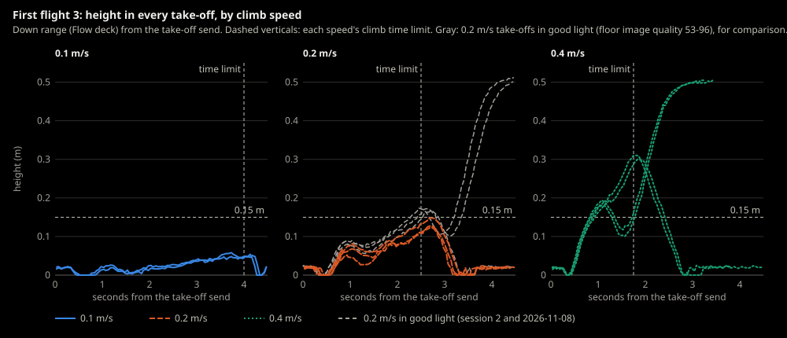
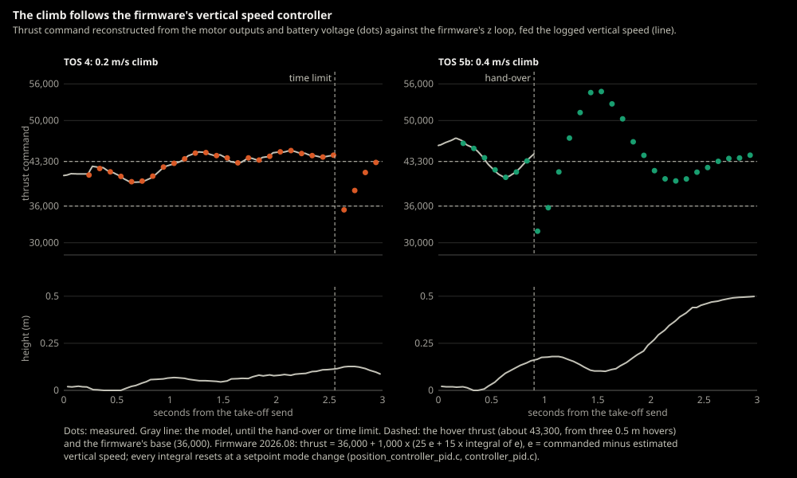
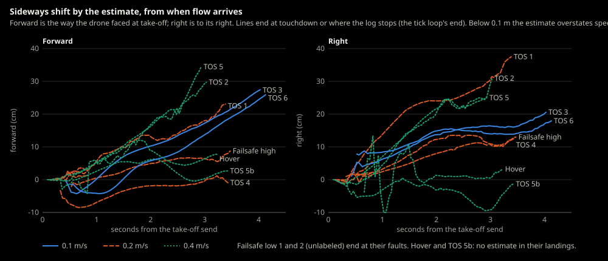
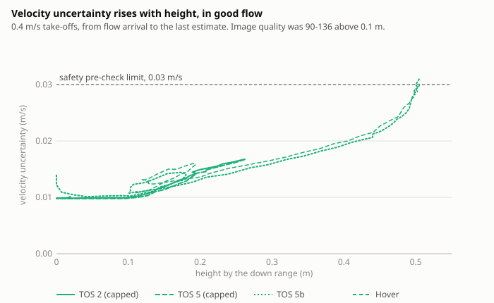
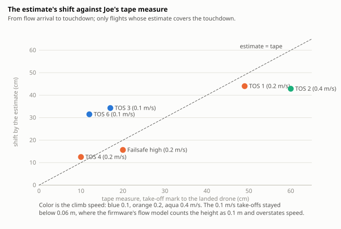

# 2026-11-09-first-flight-3-take-off-speeds

- **Session:** [First flight 3](../sessions/2026-11-09-first-flight-3.md)
- **Test:** Hover (flight), short hovers at different initial climb speeds
- **Environment:** [Living room](../environments/living-room.md), hide-and-seek launch point, low light (the room's usual night lighting, no flashlight). Time of day / sunlight: ___
- **Git commit:** `876ba6d`
- **Hardware:** Crazyflie 2.1+, decks: Flow / Multi-ranger / Buzzer, battery #
- **Firmware / cflib:** 2026.08, release 2026.10, unmodified ([ADR-0047](../../decisions/0047-pinned-firmware-release-warn-on-mismatch.md)) / 0.1.34

## Goal and pass criteria
*Written before flying.*

- Goal: find out whether the initial climb's speed changes the sideways
  drift at take-off in low light (backlog #68), using the hover program's
  `--climb-speed` ([ADR-0059](../../decisions/0059-initial-climb-speed-set-per-hover-run.md)).
  In [First flight 2](2026-11-07-first-flight-2-hover.md) the drone drifted
  18-20 cm sideways, almost all of it in the initial climb: a push of a few
  centimeters at spin-up, then a steady 0.1 m/s by the estimate.
- Pass if (this is a measurement, no pass or fail on distance):
  - [ ] At least 2 flights at each speed, 0.1, 0.2 and 0.4 m/s.
  - [ ] Every flight ends with the motors stopped after touchdown, whether
        its initial climb ended normally or the cap or the time limit landed
        it. A cap or time-limit landing is a finding, not a failure.
  - [ ] For every flight, the table below has: the speed, the battery
        voltage, the sideways shift at take-off (from the take-off mark to
        below the drone once it's hovering), the landing's distance from the
        mark, and from the log the settle height, the final descent height,
        and whether the low-light warning appeared.
- Prediction (analysis of First flight 2's estimate, not a simulator run):
  if the drift is the speed left over after the push, the shift is about
  the push plus 0.1 m/s times the level part's time (final descent height
  over climb speed). For a final descent height near 0.25 m: about 25 cm at
  0.1 m/s, 12 cm at 0.2 m/s and 6 cm at 0.4 m/s, plus the push. If the push
  grows with a faster spin-up, 0.4 m/s won't shrink the shift as much, or at
  all. Flights at the same speed that differ a lot point to something else
  (the floor, the propellers, the light).

- Flown after a failure, Joe's call (2026-11-09): Failsafe high failed (its
  climb's time limit landed it before the hover, backlog #78), so this
  session's failsafe wasn't tested from 0.5 m; the Bench wasn't flown; the
  `/project-review` hasn't run. Expect time-limit landings: the limit is
  1.75 s at 0.4 m/s, 2.5 s at 0.2 m/s and 4 s at 0.1 m/s, and Failsafe high's
  climb averaged about 0.05 m/s.

## Pre-flight checklist

- [ ] Bench, Failsafe low and Failsafe high passed: **Bench not flown,
      Failsafe high failed** (see above)
- [ ] Code committed, hash recorded above, the same commit as the session doc's mock runs
- [ ] Propellers undamaged, battery charged (voltage: ___; below 3.62 V the take-off is refused, [ADR-0051](../../decisions/0051-battery-flight-limit-and-take-off-limit.md))
- [ ] Soft landing patch under the drone, flight area clear of people and pets, at least 0.5 m clear on every side (0.1 m/s may drift about 30 cm)
- [ ] Same lighting for every flight; note any change
- [ ] Geofence configured for this space
- [ ] Video recording on, framed to see the floor marks

## During the test

- [ ] Mark the take-off point on the floor, and lay a tape measure on the
      floor through it, along First flight 2's drift (to the right), so the
      video can read the shift
- [ ] Fly in this order, so battery level and lighting changes spread over
      all speeds: 0.2, 0.4, 0.1, then again 0.2, 0.4, 0.1 (a third round if
      the batteries allow)
- [ ] Each flight: `.venv\Scripts\python -m crazyflie_behavior.programs.hover --crazyflie --hover-seconds 5 --climb-speed <speed>`
- [ ] Each flight: put the drone back on the mark facing the same way, and
      note the battery voltage from the log's opening lines
- [ ] Watch the take-off; note anything unexpected while it happens (a jump
      or tilt at spin-up, a direction change)
- [ ] After landing, measure from the take-off mark to the drone with a tape measure

## Flights

| # | Climb speed (m/s) | Battery (V) | Shift at take-off (cm) | Landing from mark (cm) | Settle / final descent height (m) | Low-light warning | Result | Data file | Notes |
|---|---|---|---|---|---|---|---|---|---|
| 1 | 0.2 | 4.00 (at rest) | | 49, forward and right | none; time limit landed it at 0.108 m | yes (28) | Time-limit landing | `logs/2026-11-09_16-50-20_hover.log` | |
| 2 | 0.4 | 3.99 (at rest) | | 60, forward and right | none; the cap landed it at 0.261 m | yes (11) | Cap landing | `logs/2026-11-09_16-51-59_hover.log` | |
| 3 | 0.1 | | | | | | Take-off refused, motors never ran | `logs/2026-11-09_16-53-43_hover.log` | Not counted as a flight |
| 3 | 0.1 | 3.93 (at rest) | | 17, forward and right | none; time limit landed it at about 0.05 m | yes (32) | Time-limit landing | `logs/2026-11-09_16-55-19_hover.log` | Second try |
| 4 | 0.2 | 3.93 (at rest) | | 10, right and forward | none; time limit landed it at 0.113 m | yes (35) | Time-limit landing | `logs/2026-11-09_16-56-27_hover.log` | |
| 5 | 0.4 | 3.91 (at rest) | | not seen | none; the cap landed it at 0.264 m | yes (13) | Cap landing | `logs/2026-11-09_16-59-11_hover.log` | Joe wasn't watching; flown again |
| 5 | 0.4 | 3.90 (at rest) | | 22 | 0.103 / 0.153 | yes (34) | Hovered at 0.5 m; landed by the safety layer (velocity uncertainty) after about 1 s | `logs/2026-11-09_17-01-55_hover.log` | Second try |
| 6 | 0.1 | 3.87 (at rest) | | 12 | none; time limit landed it at 0.049 m | yes (22) | Time-limit landing | `logs/2026-11-09_17-03-17_hover.log` | |

## Observations
What happened, especially anything surprising. Include numbers.

### Joe

- Flight 1: off by 49 cm (forward and right).
- Flight 2: 60 cm off, to the right and forward.
- Flight 3: 17 cm forward and to the right.
- Flight 4: 10 cm off (right and forward).
- Flight 5: not watched; flown again.
- Flight 5, second try: 22 cm, but about half of that looked like it came on
  the landing.
- Flight 6: 12 cm off.

### Computed from the logs (Claude)

- **Flight 1 (0.2 m/s):** before the estimate reset at connect, the estimate
  said x = -10.0 m: it ran away on the floor in the 3 minutes since Failsafe
  high. The reset cleared it. Height estimate after the take-off: 0.0 m at
  0.5 s (the spin-up), 0.052 m at 0.95 s, down to 0.029 m at 1.35 s, 0.089 m
  at 1.95 s, 0.083 m at 2.1 s, 0.115 m at 2.55 s, when the time limit landed
  it (`Final descent: level, from 0.108 m by the down range`). No
  `Initial climb done`. Shift by the estimate: by 0.6 s, 5 cm right; by the
  time limit, 26 cm right and 14 cm forward, mostly steady through the climb;
  at touchdown (3.4 s), 37 cm right and 23 cm forward. After touchdown the
  safety layer's pre-check failed "in flight", as in Failsafe high (backlog
  #79).
- **Flight 2 (0.4 m/s):** before the reset, the estimate said (-4.8, -5.9) m.
  Image quality 11-13 on the floor. Lift-off at about 0.5 s, then the height
  estimate rose about 0.4 m/s to 0.12 m at 0.75 s and about 0.15-0.2 m/s after
  that, with no sag: 0.27 m at 1.65 s. Velocity uncertainty stayed under
  0.02 m/s (flow throughout), but the horizontal speed estimate stayed around
  0.15-0.17 m/s, at or over the 0.15 m/s settle speed, so the cap landed it:
  `The horizontal speed estimate hasn't settled by 0.25 m. Landing.`, then
  `Final descent: level, from 0.261 m by the down range`. Shift by the
  estimate: by the cap, 11 cm forward and 17 cm right; at touchdown (3.05 s),
  30 cm forward and 31 cm right. After touchdown, the same pre-check failure
  as flight 1 (backlog #79).
- **Flight 3, first try (0.1 m/s):** before the reset the estimate said
  (9.0, -6.2) m at 0.33 m/s. After it, the take-off was refused: `the
  estimate is moving on the floor: 0.054 m/s (under 0.05)` (the message's
  "under 0.05" is the limit, read as "must be under"). The motors never ran.
- **Flight 3, second try (0.1 m/s):** velocity uncertainty 0.12-0.15 m/s (no
  flow) for the first 0.35 s; at 0.4 s, as flow arrived, the position
  estimate jumped about 20 cm sideways in one step. The height estimate never
  passed 0.048 m in the 4 s to the time limit (`The initial climb hasn't ended
  4 s after the take-off`). Shift by the estimate from 0.5 s, after the jump,
  to the time limit: 29 cm forward and 18 cm right. After touchdown the
  hover test, still waiting for 0.5 m, failed on its own 5 s take-off limit
  and asked to land, then the safety layer's pre-check failed "in flight"
  (backlog #79).
- **Flight 4 (0.2 m/s):** before the reset the estimate said (-37.1, 10.6) m.
  No flow for the first 0.25 s, then the estimate jumped about 9 cm in one
  step. Height estimate: 0.068 m at 1.1 s, sagged to 0.048 m at 1.5 s, 0.114 m
  at 2.5 s; the time limit landed it (`Final descent: level, from 0.113 m by
  the down range`), touchdown at 3.45 s. Shift by the estimate from 0.5 s,
  after the jump, to touchdown: 6 cm forward and 11 cm right. After touchdown,
  the same pre-check failure (backlog #79).
- **Flight 5 (0.4 m/s):** before the reset the estimate said (0.4, -3.2) m.
  Image quality 12-14 on the floor, but velocity uncertainty stayed near
  0.01 m/s from the take-off (no jump). Lift-off at about 0.5 s; the height
  estimate rose about 0.4 m/s to 0.13 m at 0.8 s, then about 0.15 m/s, with
  no sag. The cap landed it at 1.55 s (`The horizontal speed estimate hasn't
  settled by 0.25 m`, `Final descent: level, from 0.264 m`); touchdown at
  2.95 s. Shift by the estimate: 17 cm by the cap (10 cm forward, 14 cm
  right), 44 cm at touchdown (36 cm forward, 25 cm right), 19 cm of the
  forward part in the last 0.4 s before touchdown, below 0.1 m. This time the
  safety pre-check didn't fail after touchdown: the estimate held still on
  the floor, and at 5 s the hover test's own take-off limit asked to land
  and saw it landed.
- **Flight 5, second try (0.4 m/s):** the first full initial climb tonight.
  Image quality 26-40 on the floor; the estimate jumped about 5 cm at 0.3 s as
  flow arrived. `Initial climb done: settle height 0.103 m, final descent
  height 0.153 m` at 0.90 s. Then the height estimate dipped from 0.180 m
  (1.1 s) to 0.102 m (1.5-1.6 s) before the climb to 0.5 m (as backlog #69),
  and the hover test logged `at 0.42 m` at 2.35 s. Shift by the estimate
  stayed within 5 cm from 0.5 s to 3.4 s. **Velocity uncertainty rose with
  height:** 0.010 at 0.5 s, 0.014 at 0.18 m, 0.022 at 0.46 m, 0.028-0.030 at
  0.5 m, while image quality stayed about 90-110. At 3.45 s the safety
  layer's pre-check failed (`velocity uncertainty 0.031 m/s in flight (no flow
  over 0.03)`) and landed the drone: `Final descent: level, from 0.304 m`,
  touchdown at 5.47 s. The log has no estimate after 3.45 s. Analysis, not
  observed: with flow quality that good, the rise looks like the
  uncertainty growing with height rather than lost flow, which would make
  0.03 m/s too tight for a 0.5 m hover in this light. (2026-11-10: in any
  light, by the firmware source; see the analysis below.)
- **Flight 6 (0.1 m/s):** like flight 3. No flow for the first 0.5 s, then
  the estimate jumped about 8 cm. The height estimate never passed 0.06 m;
  the time limit landed it at 4.05 s (`Final descent: level, from 0.049 m`),
  touchdown at 4.15 s. Shift by the estimate from 0.8 s, after the jump, to
  touchdown: 30 cm forward and 10 cm right, at a steady rate from about
  1.4 s. After touchdown, the hover test's 5 s limit and then the safety
  pre-check "in flight" (backlog #79), as in flight 3.
- **Across the six flights (analysis):** only 0.4 m/s climbed out of the
  first few centimeters; 0.2 m/s reached about 0.11-0.12 m and 0.1 m/s about
  0.05 m before their time limits. So no speed but 0.4 m/s answered the
  test's question, and at 0.4 m/s one of three climbs settled. Each slow
  climb drifted mostly forward and right at a steady rate while it stayed
  low, as First flight 2 did (backlog #68).

### Analysis, 2026-11-10 (Claude)

From the logs of sessions 2 and 3 and the 2026-11-08 flights, and the
firmware 2026.08 source. Analysis, not observations. Scripts in
`drafts/ff3/` (git-ignored, backlog #55).

- **Why the slow climbs failed: the firmware's vertical speed controller, in
  any light.** Its thrust command is 36,000 + 1,000 × (25 e + 15 × the
  integral of e), where e is the commanded minus the estimated vertical speed
  (`position_controller_pid.c` 236-266, `platform_defaults_cf2.h` 142-156).
  Every controller integral restarts at zero at a setpoint mode change and on
  the floor (`controller_pid.c`, `setpointModeChanged`). This drone hovers at
  a thrust command of about 43,300 (three 0.5 m hovers in session 2 and on
  2026-11-08, reconstructed from the motor outputs and battery voltage
  through the firmware's battery compensation), so every take-off waits for
  the integral to make up about 7,300. Fed the logged vertical speed, the
  formula matches the reconstructed thrust command within about 1% (flight 4,
  second chart). At 0.1 m/s the drone left the floor only at 2.8-2.9 s. At
  0.2 m/s it left at 0.6-0.8 s, then stalled at 1.0-1.5 s while the integral
  caught up as ground effect faded. At 0.4 m/s it left at 0.53 s. The 0.2 m/s
  take-offs in good light (session 2's Hover flight 5, image quality 96 on
  the floor, and 2026-11-08) climbed the same way (gray lines below).
- **The dip after the hand-over (backlog #69) is the same restart:** in
  flight 5's second try the thrust command fell from about 44,500 to 31,900
  at the switch to the high-level climb (the integral restarts, and the
  planner starts at zero speed), and the drone fell 7.8 cm. The level final
  descent after a landing approach is a mode change too: the Hover's took
  about 0.6-0.8 s from 0.30 m, about twice the commanded speed.
- **Thrust wasn't the limit:** the highest motor output in any flight was
  62,672 of 65,535, never capped.
- **The cap landings (flights 2 and 5) were real drift, not bad flow:** a tilt
  of about 0.5-1° to the right and forward in the first second after lift-off
  gave 0.1-0.2 m/s by the estimate, and the level climb never brakes it, so
  the speed never settled under 0.15 m/s.
- **Velocity uncertainty (backlog #80):** the Flow deck's noise is fixed at 2
  pixels by default (`flowdeck_v1v2.c`), and the flow model divides speed by
  height (`mm_flow.c`), so the uncertainty grows with height with good flow:
  0.010 m/s at 0.1-0.2 m, about 0.023 at 0.47 m, 0.030 at 0.5 m and still
  rising, with image quality 90-110. Where it settles at 0.5 m isn't known:
  neither hover lasted 1 s there.
- **Yaw:** motors 1 and 3 ran above 2 and 4 in every flight, a pure yaw
  command (roll and pitch commands stayed small). In steady hover,
  (m1+m3)/(m2+m4) was 1.11-1.21 on 2026-11-07, 1.40-1.45 on 2026-11-08 and
  1.34-1.38 here. The drone turned 13-15° by the end of every climb and up to
  28° after the hand-over. The level climb does hold the heading
  (`controller_pid.c` 84-86); the disturbance is larger than the yaw loop
  cancels quickly (backlog #83).
- **The estimate's shift against the tape** (last chart): close for the
  flights that climbed above 0.1 m; about twice the tape for the 0.1 m/s
  flights, which stayed under 0.06 m, where the flow model counts the height
  as 0.1 m.

## Next
- Code changes:
- Simulator model changes:
- ADRs to write or revisit:
- Next session's goal:
