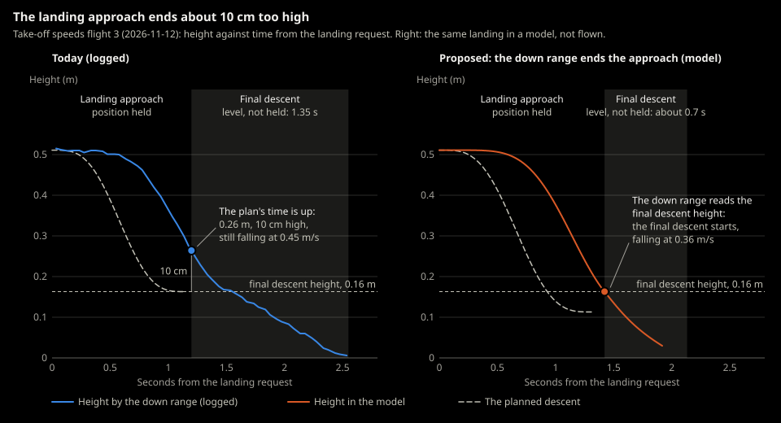

# 2026-11-12-first-flight-4-take-off-speeds

> Flown 2026-11-12, 16:17 to 16:23 Pacific, at night. The Flights table and
> "Computed from the logs" are by Claude, from the recorded logs. Pass or
> fail, and Joe's own observations, are Joe's to write.

- **Session:** [First flight 4](../sessions/2026-11-12-first-flight-4.md)
- **Test:** Take-off speeds (a flight test, no pass or fail on distance)
- **Environment:** [Kitchen](../environments/kitchen.md), center of the room, all lights on, night (Joe).
- **Git commit:** `8d7bc29`
- **Hardware:** Crazyflie 2.1+, decks: Flow / Multi-ranger / Buzzer, battery #: ___
- **Firmware / cflib:** 2026.08 (as in session 3, not re-read) / 0.1.34

## Goal and pass criteria
*Written before flying.*

- Goal: as in [First flight 3](2026-11-09-first-flight-3-take-off-speeds.md):
  how the sideways drift at take-off changes with the initial climb's speed
  ([ADR-0059](../../decisions/0059-initial-climb-speed-set-per-hover-run.md),
  backlog #68). No new criteria were written; this session flew one flight per
  speed (the template asked for at least 2).
- Pass if: a measurement, no pass or fail on distance.

## During the test

- [x] Each flight: `.venv\Scripts\python -m crazyflie_behavior.programs.hover --crazyflie --hover-seconds 5 --climb-speed <speed> --take-off-log`
- [x] Order 0.1, 0.2, 0.4 (not the template's 0.2, 0.4, 0.1)
- [ ] Take-off mark and tape measure, video: not recorded

## Flights

| # | Climb speed (m/s) | Battery (V) | Shift at take-off (cm) | Landing from mark (cm) | Settle / final descent height (m) | Low-light warning | Result | Data file | Notes |
|---|---|---|---|---|---|---|---|---|---|
| 1 | 0.1 | 3.82 (at rest) | | 7, right and slightly back (Joe) | 0.117 / 0.167 | yes (11) | Hovered at 0.52 m (down range), landed | `logs/2026-11-12_16-17-38_hover.log` | |
| - | 0.2 | 3.81 (at rest) | | | | | Take-off refused: estimate moving on the floor, 0.076 m/s | `logs/2026-11-12_16-19-07_hover.log` | Not counted as a flight |
| 2 | 0.2 | 3.80 (at rest) | | 9, right and slightly back (Joe) | 0.103 / 0.153 | yes (9) | Hovered at 0.52 m (down range), landed | `logs/2026-11-12_16-21-26_hover.log` | |
| 3 | 0.4 | 3.78 (at rest) | | 3.5, right (Joe) | 0.113 / 0.163 | yes (14) | Hovered at 0.51 m (down range), landed | `logs/2026-11-12_16-23-01_hover.log` | |

The hover heights are the mean down range in the hover (corrected 2026-11-13: this
table first gave 0.42, 0.41 and 0.40 m, the heights at which the hover test counted
the drone as there, within 0.1 m of 0.5 m).

## Observations
What happened, especially anything surprising. Include numbers.

### Joe

Joe measured where each flight landed from the mark, not the sideways shift at take-off, so the "Shift at take-off" column is empty.

- Result: pass.
- 0.1 m/s: landed 7 cm to the right and slightly back of the mark.
- 0.2 m/s: landed 9 cm to the right and slightly back of the mark.
- 0.4 m/s: landed 3.5 cm to the right of the mark.
- Tried to fly 0.6 m/s; the program's maximum is 0.4 (ADR-0059). Joe
  decided against changing the code.

### Computed from the logs (Claude)

- All three flights ended the initial climb normally and reached the hover;
  no cap or time-limit landing (session 3: only 0.4 m/s climbed). Each hovered
  5 s, final descent level, touchdown confirmed, 0 overruns.
- First flight 3's prediction (about 25, 12 and 6 cm at 0.1, 0.2 and 0.4 m/s,
  plus the push) was for the shift at take-off; Joe measured where each flight
  landed, which includes the hover and the landing, so the two can't be
  compared. One flight per speed can't separate speed from luck, the light,
  the new M1 propeller or the fresh estimate.
- M1 had a spare propeller from the package for these flights (propeller test,
  backlog #83).
- Estimate before the reset at connect: flight 1 (0.00, 0.20) m; the refused
  attempt (-4.1, -4.8) m; flight 2 (-1.06, -10.9) m at 1.3 m/s, implausible
  on the floor; flight 3 (0.10, 0.64) m. The refused attempt's take-off was
  refused because the speed on the floor was 0.076 m/s, over the 0.05 limit.
- Battery at rest fell from 3.82 to 3.78 V over the three flights; minimum
  under load 3.33, 3.35 and 3.28 V.

## Analysis (Claude, 2026-11-13)

From the logs and the firmware 2026.08 source, not observations. Scripts in
`drafts/ff4/` (not in the repository).

- **The initial climb:** lift-off (the down range up 1.5 cm) at 0.53, 0.43 and
  0.43 s, and the climb done 1.45, 0.80 and 0.70 s after the take-off: the
  thrust base of 43,000
  ([ADR-0061](../../decisions/0061-thrust-base-set-at-connect.md)) fixed the
  slow climbs (backlog #78). No dip after the hand-over to the high-level
  climb (backlog #69): the drone kept rising 0.6-1.6 cm.
- **Balance:** with the spare M1 propeller, M1 and M3 carried the same share
  of the thrust command (within 0.9 points), and the motors cancelled almost
  no steady torque (as a centre-of-mass offset, under 0.5 mm). The yaw
  imbalance remains: (m1+m3)/(m2+m4) was 1.26-1.31 in the hovers (backlog #83).
- **Sideways movement, by the position estimate (cm).** Below 0.10 m the
  firmware's flow model overstates movement, so each value is the estimate
  corrected for that, with the estimate as logged in brackets. The logs see
  little of the first and last 10 cm of height, and their totals differ from
  Joe's tape by about 5-12 cm.

  | # | Climb (m/s) | Take-off, floor to hover | In the 5 s hover | Landing, request to motors off | Whole flight | Joe's tape |
  |---|---|---|---|---|---|---|
  | 1 | 0.1 | 3 back (8) | 3 back and left | 6 back (9) | 11 back (18) | 7, right and slightly back |
  | 2 | 0.2 | 2.5 right (5) | 4 left | 4 back and right (8) | 2 (9, back and right) | 9, right and slightly back |
  | 3 | 0.4 | 3 forward and right (6) | 2.5 right | 2 forward (3) | 6 forward and right (8) | 3.5, right |

- **At the hand-over** (the end of the initial climb, good flow) the drone
  was moving sideways at 0.04, 0.05 and 0.11 m/s, each time mostly to the
  right. The high-level climb's position hold stopped it within 2.3-3.3 cm.
- **The landing approach ended 10-11 cm above the final descent height**
  (0.26-0.27 m against 0.15-0.17 m), with the drone still descending at
  0.45 m/s: the plan's time ran out first (backlog #93). The level final
  descent then lasted 1.35-1.40 s, started with 0.02-0.06 m/s of sideways
  speed, and moved the drone 3.3-5.5 cm before it was under 0.10 m.

  

- **Battery at spin-up:** the first reading after the motors started was
  3.16, 3.10 and 3.05 V, under the 3.20 V low-battery limit for up to about
  0.2 s. The once-a-second reading the safety pre-check judges came
  0.07-0.08 s before each take-off, so it missed the dip (backlog #91).
- **The take-off block** added no lateness: in its 2 s the worst tick
  lateness was 1.8 ms, with no overrun, and the position estimate and down
  range were at most 25 ms old (the stale limit is 0.25 s).

## Next
- Code changes:
- ADRs to write or revisit: backlog #68, #81
- Next session's goal: a second round at each speed, in the same light.
