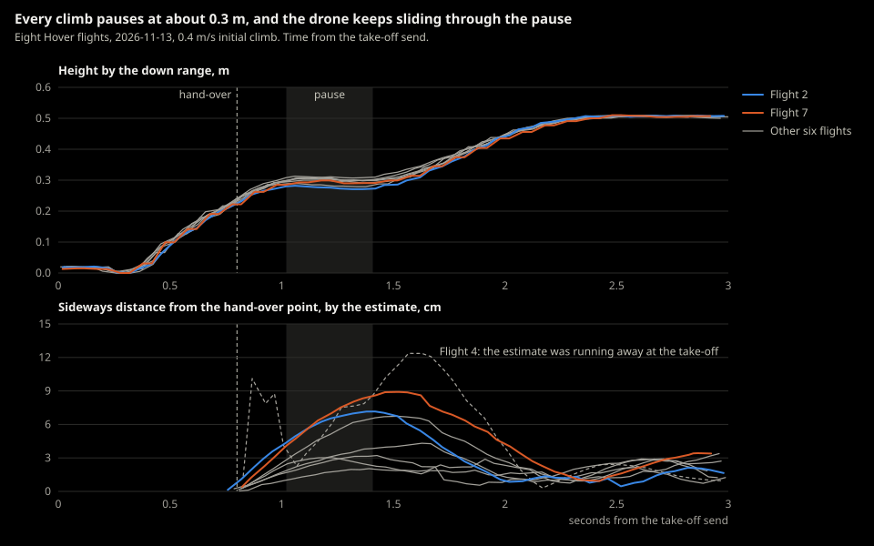

# 2026-11-13-first-flight-5-hover

> Flown 2026-11-13, 11:01 to 11:21 Pacific, in daylight. The Flights table and
> "Computed from the logs" are by Claude, from the recorded logs. Pass or
> fail, and Joe's own observations, are Joe's to write.

- **Session:** [First flight 5](../sessions/2026-11-13-first-flight-5.md)
- **Test:** Hover (flight), with chirps
- **Environment:** [Kitchen](../environments/kitchen.md), center of the room, all lights on, daylight (Joe).
- **Git commit:** `c7ecffe`
- **Hardware:** Crazyflie 2.1+, decks: Flow / Multi-ranger / Buzzer, battery #: ___ (one battery for all eight flights, Joe)
- **Firmware / cflib:** 2026.08 (as in session 4, not re-read) / 0.1.34

## Goal and pass criteria
*Written before flying.*

- Goal: none written before flying (Joe's call). Joe's aim, said before the
  flights: "a few more test flights today to add to the data in session 4 …
  the hover test with chirps with a 0.4m/s take off and all the debug
  logging on".
- Pass if: not written before flying. The program's own rule
  ([ADR-0062](../../decisions/0062-hover-program-fails-when-the-hover-is-cut-short.md)):
  exit code 0 unless the hover was cut short; the codes were not captured.

## During the test

- [x] Each flight: `.venv\Scripts\python -m crazyflie_behavior.programs.hover --crazyflie --hover-seconds <60 or 10> --chirp --climb-speed 0.4 --take-off-log`, started by Claude in a terminal tab
- [x] Propeller test runs after flight 6 and after flight 8 (session doc)

## Flights

| # | Hover | Battery at rest (V) | Low-light warning (image quality) | Result | Data file | Notes |
|---|---|---|---|---|---|---|
| 1 | 60 s | 4.07 | yes (34) | Hovered 60 s at 0.50 m (down range), landed | `logs/2026-11-13_11-01-44_hover.log` | |
| 2 | 10 s | 3.93 | yes (23) | Hovered 10 s at 0.51 m, landed | `logs/2026-11-13_11-04-41_hover.log` | |
| 3 | 10 s | 3.90 | yes (25) | Hovered 10 s at 0.51 m, landed | `logs/2026-11-13_11-06-36_hover.log` | |
| 4 | 10 s | 3.87 | yes (11) | Hovered 10 s at 0.51 m, landed | `logs/2026-11-13_11-08-16_hover.log` | The estimate ran away at the take-off |
| 5 | 10 s | 3.84 | yes (25) | Hovered 10 s at 0.51 m, landed | `logs/2026-11-13_11-09-04_hover.log` | |
| 6 | 10 s | 3.83 | yes (12) | Hovered 10 s at 0.51 m, landed | `logs/2026-11-13_11-10-27_hover.log` | Propeller test runs 1-2 after it, after a power cycle |
| 7 | 10 s | 3.79 | yes (41) | Hovered 10 s at 0.51 m, landed | `logs/2026-11-13_11-18-57_hover.log` | Joe picked the drone up after it landed: the safety pre-check failed on the drone's tumble report and the tick loop stopped before "Charge" |
| 8 | 10 s | 3.76 | yes (34) | Hovered 10 s at 0.51 m, landed | `logs/2026-11-13_11-20-45_hover.log` | Propeller test runs 3-6 after it |

## Observations
What happened, especially anything surprising. Include numbers.

### Joe

- Result: fail. "I would say it failed due to propeller issues."
- "sometimes the drift happened after the drone slowed down during the
  ascent. it would lose momentum and drift sideways, this happened at least
  once or twice"
- Landed generally 7-15 cm from the mark; exact distances not remembered.
- Heard "Charge" after each landing.
- Same battery for all eight flights. Joe shifted it around to counter the
  direction of the drift; it didn't seem to affect the flights.
- Picked the drone up after flight 7 landed.
- "I think I need to replace the M4 propeller at least, and maybe the motor
  too. I find the propeller really difficult to pop off."
- Aim after the session: "problem solve the propeller issues and get more
  data about landing/takeoff". Considered ignoring the hardware problems to
  focus on behavior and code; later chose one time-boxed hardware pass
  (backlog #83).

### Computed from the logs (Claude)

Times are seconds from the take-off send. Session 4's comparison flights are
its 0.4 m/s Take-off speeds flight and its Hover.

- **Every flight took off, hovered its full time and landed**, touchdown
  confirmed. In the hover: position standard deviation 0.7-1.8 cm, height
  0.4-0.8 cm; velocity uncertainty mean 0.032-0.033 m/s, highest 0.038, against
  [ADR-0064](../../decisions/0064-in-flight-flow-limit-grows-with-height.md)'s
  limit of 0.05 at 0.5 m. Tick loop: no overruns in any flight, worst lateness
  27.65 ms (flight 5), 99th percentile 1.41-1.72 ms.
- **The climb pauses at about 0.3 m.** At the hand-over (0.75-0.80 s, down
  range 0.21-0.24 m, climbing at 0.36-0.41 m/s) the thrust command fell from
  about 42,500 to 32,900-33,800. The vertical speed then stayed under
  0.10 m/s for 0.34-0.40 s (from about 1.0 to 1.4 s) at 0.28-0.31 m, sinking
  up to 1 cm, before the climb went on to 0.5 m. Session 4: 0.26 s, never
  below +0.06 m/s.
- **The drone kept sliding through the pause**, at the sideways speed it had
  at the hand-over (0.01-0.16 m/s). Farthest from the hand-over point within
  1.2 s, by the estimate, flights 1-8: 2.9, 7.2, 4.3, 12.4, 3.0, 3.2, 8.9 and
  6.7 cm, at 1.2-1.9 s; back within 1.0-3.4 cm by 3 s. Flight 4's number is
  less sure (its estimate ran away at the take-off, below).

  

- **The motor balance changed from flight to flight, and the hover took more
  thrust.** Hover means from the controller block and the motors. "M1 over
  M3" is the pitch command minus the roll command, "M2 over M4" minus both
  (the firmware's legacy mixing), in thrust command units.

  | # | Thrust command | Roll / pitch command | M1 over M3 | M2 over M4 | (m1+m3)/(m2+m4) |
  |---|---|---|---|---|---|
  | 1 | 44,610 | -948 / -962 | -14 | +1,910 | 1.179 |
  | 2 | 45,561 | -4,017 / +3,313 | +7,330 | +704 | 1.312 |
  | 3 | 45,393 | -2,706 / +2,365 | +5,071 | +341 | 1.327 |
  | 4 | 44,741 | -951 / +204 | +1,155 | +747 | 1.128 |
  | 5 | 44,813 | -801 / +148 | +949 | +653 | 1.269 |
  | 6 | 45,140 | -1,797 / +1,059 | +2,856 | +738 | 1.307 |
  | 7 | 46,297 | -3,972 / +3,333 | +7,305 | +639 | 1.263 |
  | 8 | 45,424 | -2,936 / +738 | +3,674 | +2,198 | 1.415 |
  | Session 4, 0.4 m/s | 43,060 | -383 / -437 | -54 | +820 | 1.317 |
  | Session 4, Hover | 43,458 | +134 / -9 | -143 | -125 | 1.243 |

  In flights 2 and 7, M1 was commanded 16% more thrust than M3; in flights 4
  and 5, about 2%. In flight 1's 60 s the commands moved too (roll from +841
  to -2,196, the ratio from 1.31 to 1.11, in 10 s bins). The thrust command
  was 44,600-46,300 against 43,000-43,500 in sessions 3 and 4 (3-7% more),
  didn't follow the battery voltage, and was highest in the flights with the
  largest imbalance.
- **The same imbalance at take-off.** Lift-off at 0.38-0.46 s; vertical
  speed peak 0.51-0.54 m/s (session 4: 0.61). From lift-off to the
  hand-over, flights 2 and 7 tilted most, right side down and nose down
  (roll +1.07° and +0.75°, pitch -0.73° and -0.40°), with the largest rate
  integrals (roll -2,330 and -2,254, pitch +1,766 and +1,525), and left the
  level climb fastest sideways (0.14 and 0.16 m/s): session 4's Failsafe
  pattern, forward-right, M1's corner low. The other six tilted at most 0.53°
  in roll and 0.36° in pitch. Yaw turned 12.8-15.0° by the hand-over and up
  to 21-27° after it. The busiest motor reached 62,730 of 65,535 at spin-up
  (flight 7).
- **Landings** (backlog #93, since decided in
  [ADR-0068](../../decisions/0068-landing-approach-aims-below-the-final-descent-height.md)):
  the landing approach ended by its time
  (1.05-1.20 s) at 0.263-0.331 m, still descending at 0.47-0.50 m/s; the
  final descent heights were 0.151-0.192 m, so it ended 11-17 cm high. The
  final descent took 1.10-1.30 s at 0.22-0.27 m/s. Movement in the final
  descent by the estimate, which is unreliable in the bad-flow zone, flights
  1-8: 7.4, 18.7, 18.4, 3.4, 10.2, 10.8, 28.5 and 15.8 cm, mostly forward
  and/or right, with tilt up to +0.98° roll and -1.15° pitch (flight 3). Take-off
  point to touchdown by the estimate: 12.0, 22.4, 22.9, n/a, 13.1, 12.0, 33.8
  and 19.0 cm. In session 4 the logs' totals differed from Joe's tape by
  5-12 cm.
- **Estimate runaway at a take-off** (backlog #81), in daylight. Flight 4: at
  the take-off send the velocity uncertainty was 0.66 m/s and the speed
  estimate 0.46 m/s; the estimate moved 1.6 m in the first 0.6 s as flow
  arrived. The flight was otherwise normal. The estimate before the reset at
  connect, flights 2-8, in m: (3.2, -0.1), (5.5, 0.3), (12.6, -8.2) flagged
  implausible, (-0.7, 0.1), (0.6, -0.7) flagged, (-1.7, -0.6), (9.3, -10.3).
- **The low-light warning fired at every take-off, in daylight** (backlog
  #96). Image quality on the floor 11-41 (session 4 at night: 12-26); in the
  hover 131-139 (at night: 124-126). The shutter read its maximum, 8191,
  nearly throughout.
- **Battery** (backlog #91). At rest before flights 1-8: 4.07, 3.93, 3.90,
  3.87, 3.84, 3.83, 3.79 and 3.76 V. Lowest 100 ms sample at spin-up: 3.46,
  3.38, 3.21, 3.31, 3.17, 3.23, 3.15 and 3.08 V (a sag of 0.55-0.69 V);
  under the 3.20 V limit in flights 5, 7 and 8, none landed by the safety
  pre-check. Flight 1's 60 s hover from 4.07 V ended at 3.49 V under load.
  Flight 8's landing reached 3.23 V.
- **"Charge"** (backlog #92): logged as played in 7 of 8 flights. Flight 7's
  tick loop stopped 2.2 s before it was due.

## Analysis (Claude, 2026-11-13)

From the logs, not observations. Scripts in `drafts/ff5/` and `drafts/ff4/`
(not in the repository).

- **The pause is backlog #69's mechanism:** the hand-over to the high-level
  climb restarts the controller integrals, and the `go_to` starts at zero
  speed. Likely why it's longer now: the hover took 3-7% more thrust, so the
  thrust base of 43,000 sits further under it
  ([ADR-0061](../../decisions/0061-thrust-base-set-at-connect.md), backlog
  #97).
- **The pause doesn't cause the slide;** the sideways speed is already there
  at the hand-over. The pause gives it longer before the position hold
  catches it.
- **What changed the balance.** A fixed defect would give the same balance
  every flight; something that moves gives a different one each time.
  Candidates the logs can't separate: M1's propeller (the spare fitted on
  2026-11-12) slipping or not seated, the M1 motor, the battery's position
  (Joe moved it between flights), a heavier battery. A battery shift moves
  the roll and pitch commands, but by the mixing it hardly changes
  (m1+m3)/(m2+m4), which moved from 1.13 to 1.42 between flights, so it
  can't be the whole story (an inference: the yaw command isn't logged). The
  propeller test can't see lost thrust, and M1's vibration reads normal. M4's
  vibration jump after flights 7 and 8 shows no matching thrust loss in
  flight 8 (backlog #83).
- **Flight 7's end:** after touchdown the hover test still waits about 8 s to
  play "Charge", with the safety pre-check running. Picking the drone up in
  that time fails the pre-check and stops the tick loop. Harmless with the
  motors off, but the run ends early.

## Next
- Code changes: none decided.
- ADRs to write or revisit: backlog #69, #83, #96, and #97 (ADR-0061's
  thrust base).
- Next session's goal: the hardware pass first (Joe, backlog #83), then
  session 6.
